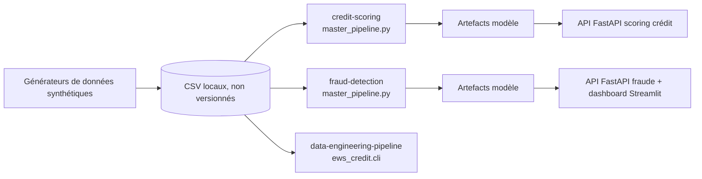

# ds-finance-quant

Projets de data science appliqués à la finance quantitative : scoring de crédit IFRS 9, détection de fraude sur transactions et génération de portefeuilles synthétiques de risque de crédit, tous construits sur des données synthétiques calibrées sur le contexte UEMOA.

## Problème traité

Les données bancaires réelles (clients, transactions, impayés) sont confidentielles. Ce dépôt reconstitue des jeux de données synthétiques réalistes, puis construit dessus les chaînes de traitement qu'un service de risque utiliserait : modèle de probabilité de défaut avec provisionnement ECL, scoring de fraude à fort déséquilibre de classes, suivi mensuel d'un portefeuille avec classification en stages IFRS 9.

## Sous-projets

| Dossier | Contenu | Technologies principales |
|---|---|---|
| [`projects/credit-scoring`](projects/credit-scoring) | Modèle de probabilité de défaut à 12 mois : EDA, preprocessing comparé, sélection de variables par consensus, benchmark de modèles (dont EBM), calibration, scénarios macro, calcul d'ECL, API de scoring | scikit-learn, LightGBM, XGBoost, interpret (EBM), SHAP, LIME, FastAPI |
| [`projects/fraud-detection`](projects/fraud-detection) | Détection de fraude sur transactions : features transactionnelles, comportementales et de graphe, Isolation Forest, autoencodeur, LightGBM, stacking, seuil adaptatif (bandit), API et dashboard | LightGBM, PyTorch, imbalanced-learn, networkx, FastAPI, Streamlit |
| [`projects/data-engineering-pipeline`](projects/data-engineering-pipeline) | Générateur de portefeuille de crédit (clients, crédits, panel mensuel de retards, labels de bascule en défaut à 3 mois) avec règles IFRS 9 isolées dans un module de domaine | pandas, numpy |
| [`projects/stress-testing`](projects/stress-testing) | Générateur de données macroéconomiques UEMOA, de portefeuille de prêts et de scénarios de stress | pandas, numpy |

## Architecture



Chaque sous-projet est autonome (son propre `requirements.txt`, ses tests, son README).

## Installation

Python 3.11 recommandé. Chaque sous-projet s'installe séparément :

```bash
git clone <url-du-depot>
cd ds-finance-quant/projects/credit-scoring   # ou fraud-detection, data-engineering-pipeline
python -m venv .venv
source .venv/bin/activate        # Windows : .venv\Scripts\activate
pip install -r requirements.txt
```

## Usage

```bash
# Scoring de crédit : génération des données puis pipeline complet
cd projects/credit-scoring
python src/data/generator.py
python master_pipeline.py

# Détection de fraude
cd projects/fraud-detection
python src/data/generate_fraud_data.py
python master_pipeline.py

# Portefeuille de crédit synthétique
cd projects/data-engineering-pipeline
PYTHONPATH=src python -m ews_credit.cli --n-clients 15000

# Données de stress testing
cd projects/stress-testing
python generate_stress_data.py
```

Les détails (API, Docker, inférence) sont dans le README de chaque sous-projet. La variable `MODEL_DIR` de l'API de scoring de crédit est documentée dans `.env.example`.

## Structure du dépôt

```
ds-finance-quant/
├── projects/
│   ├── credit-scoring/            src/, api/, tests/, notebooks/, data/external/ (échantillon macro)
│   ├── fraud-detection/           src/, api/, dashboard/, tests/, notebooks/
│   ├── data-engineering-pipeline/ src/ews_credit/ (config, domain, generation, cli)
│   └── stress-testing/            generate_stress_data.py
├── .env.example
├── .gitignore
└── LICENSE
```

## Tests

```bash
cd projects/credit-scoring && python -m pytest tests
cd projects/fraud-detection && python -m pytest tests
```

Les tests du scoring de crédit (prétraitement, ECL) et de la fraude (métriques, Isolation Forest, split temporel) ont été exécutés avec succès lors de la mise en forme du dépôt. `fraud-detection/tests/test_inference.py` suppose des modèles entraînés dans `outputs/models/` ; il n'a pas pu être validé dans l'environnement de nettoyage (échec de PyTorch sous Python 3.14). Le sous-projet `data-engineering-pipeline` n'a pas de tests automatisés.

## Limites connues

- Toutes les données sont synthétiques : les performances mesurées reflètent le générateur, pas un portefeuille réel.
- Les artefacts de modèles et les jeux de données ne sont pas versionnés ; il faut relancer les pipelines pour les reproduire (plusieurs minutes de calcul, plusieurs Go de RAM possibles pour la fraude).
- Les `master_pipeline.py` sont des scripts séquentiels longs, non découpés en modules testables.
- Les notebooks sont livrés sans sorties d'exécution.
- Le dépôt n'a pas de pipeline d'intégration continue.

## Licence

Licence : tous droits réservés. Voir [LICENSE](LICENSE).

## Contact

Jean-Paul ADOGLI, GitHub : [Jean-Paul15](https://github.com/Jean-Paul15)
