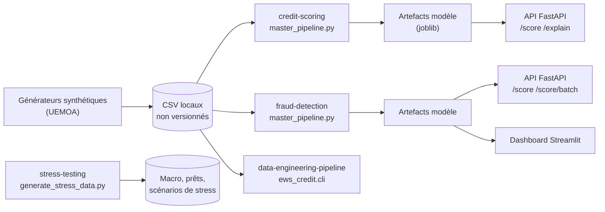

# ds-finance-quant

Quatre chaînes de risque bancaire, de la génération des données jusqu'aux API de scoring, bâties sur des données synthétiques parce que les vraies sont confidentielles et que le modèle doit rester honnête quand même.

## Ce que ça apporte

- **Des chaînes complètes, pas des notebooks isolés.** Scoring de crédit IFRS 9 (probabilité de défaut, provision ECL, API FastAPI), détection de fraude (Isolation Forest, autoencodeur, LightGBM, stacking, API et dashboard Streamlit), générateur de portefeuille et données de stress testing.
- **Des garde-fous contre l'optimisme.** Split temporel strict avec contrôle de fuite, calibration isotonique sur des données non rééchantillonnées, validation en laissant un pays de côté (`leave_one_country_out`).
- **Un métier isolé du bruit.** Les règles IFRS 9 de classement en stages vivent dans des fonctions pures, testables, séparées de la génération aléatoire. Les tests couvrent l'ECL, le prétraitement, les métriques de fraude, l'Isolation Forest et le split temporel.

## Le problème

Un service de risque ne peut pas publier ses clients, ses transactions ni ses impayés. Impossible alors de montrer comment on construit un modèle de défaut ou de fraude. Ce dépôt reconstitue des jeux de données synthétiques dans le contexte UEMOA, puis applique dessus la méthode d'un vrai service de risque. Un exemple : si l'on évalue un modèle de fraude sur un tirage aléatoire, ses variables agrégées laissent filtrer des fraudes futures. Le score paraît excellent et ne tient pas en production. Le dépôt coupe donc le temps net entre apprentissage et test, et le vérifie.

## Démarrer en cinq minutes

Le sous-projet le plus léger ne demande que pandas et numpy. Il génère un portefeuille de crédit avec son panel mensuel de retards.

```bash
git clone <url-du-depot>
cd ds-finance-quant/projects/data-engineering-pipeline
pip install -r requirements.txt
PYTHONPATH=src python -m ews_credit.cli --n-clients 15000
```

Quatre fichiers (`clients.csv`, `credits.csv`, `panel_mensuel.csv`, `labels.csv`) sortent dans `data/synthetic/`, avec le taux de bascule en défaut à 3 mois affiché en fin d'exécution. Pour le scoring de crédit et la fraude, lancez `python src/data/generator.py` puis `python master_pipeline.py` (crédit), ou `python src/data/generate_fraud_data.py` puis `python master_pipeline.py` (fraude), depuis le dossier du sous-projet. Python 3.11 est la version des Dockerfile.

## Comment ça marche



Trois choix structurent le code.

**Les règles IFRS 9 dans un module pur.** `domain/ifrs9.py` classe un encours en stage 1, 2 ou 3 d'après ses jours de retard (seuils de 30 et 90 jours, définis dans `config.py`). Aucune dépendance, aucun aléa. Le générateur de panel (`behavior.py`) importe cette définition : une règle change à un seul endroit.

**Le temps coupé net.** `preprocessing/split.py` sépare l'apprentissage (avant la date de coupure) du test (après), et `check_temporal_leakage` signale tout chevauchement. En fraude, les adversaires s'adaptent : un modèle doit être jugé sur un futur qu'il n'a pas vu.

**Rééquilibrer sans fausser les probabilités.** La fraude est rare. Le pipeline applique SMOTE à l'apprentissage, puis calibre LightGBM (isotonique) sur une part des données d'origine non rééchantillonnées. Le modèle apprend sur une classe fraude renforcée (15 % après SMOTE), mais ses probabilités restent lisibles. En crédit, la provision se calcule comme PD × LGD × EAD × facteur d'actualisation, avec une pondération de scénarios (`calculate_scenario_weighted_ecl`).

Côté données, le générateur de portefeuille module ses transitions de retard avec des fréquences mesurées dans le jeu Kaggle Home Credit Default Risk (documentées dans `config.py`), plutôt que des taux choisis au hasard.

## Stack

| Domaine | Outils |
|---|---|
| Données et calcul | pandas, numpy, scikit-learn |
| Modèles de crédit | LightGBM, XGBoost, interpret (EBM), SHAP, LIME |
| Modèles de fraude | LightGBM, PyTorch, imbalanced-learn, networkx |
| Services | FastAPI, Streamlit, Docker et docker-compose |
| Tests | pytest |

## Structure du dépôt

```
ds-finance-quant/
├── projects/
│   ├── credit-scoring/            src/, api/, tests/, notebooks/, data/external/ (échantillon macro)
│   ├── fraud-detection/           src/, api/, dashboard/, tests/, notebooks/
│   ├── data-engineering-pipeline/ src/ews_credit/ (config, domain, generation, cli)
│   └── stress-testing/            generate_stress_data.py
├── .env.example                   MODEL_DIR de l'API de scoring de crédit
├── .gitignore
└── LICENSE
```

Chaque sous-projet a son `requirements.txt` (sauf `stress-testing`, un script unique) et son README : [credit-scoring](projects/credit-scoring), [fraud-detection](projects/fraud-detection), [data-engineering-pipeline](projects/data-engineering-pipeline), [stress-testing](projects/stress-testing). Pour lancer les tests : `pip install pytest`, puis `python -m pytest tests` dans `credit-scoring` ou `fraud-detection`.

## Limites et suite

Le périmètre est un choix : montrer la méthode, pas un portefeuille.

- **Données synthétiques.** Les performances mesurées décrivent le générateur. Elles servent à éprouver la chaîne, pas à prédire un portefeuille réel.
- **Reproduction par calcul.** Jeux de données et artefacts de modèles ne sont pas versionnés. Relancer un pipeline prend plusieurs minutes, et la fraude demande beaucoup de mémoire.
- **Pipelines en scripts.** Les `master_pipeline.py` s'exécutent de bout en bout. Les briques réutilisables vivent dans `src/` et sont testées ; le découpage du reste en modules est la suite logique.
- **Tests à étendre.** `data-engineering-pipeline` n'en a pas encore. `fraud-detection/tests/test_inference.py` suppose des modèles déjà entraînés dans `outputs/models/`.
- **Notebooks sans sorties** et **pas d'intégration continue** à ce stade.

## Licence

Tous droits réservés. Lecture du code autorisée à des fins d'évaluation. Voir [LICENSE](LICENSE).

## Contact

Jean-Paul ADOGLI, GitHub : [Jean-Paul15](https://github.com/Jean-Paul15)
